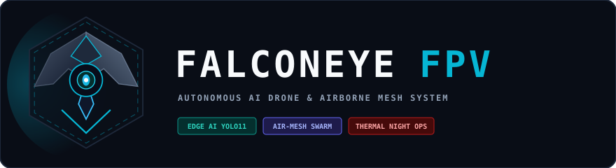

# FalconEye FPV

<p align="center">
  
</p>

> **Autonomous AI FPV Drone System, Live Operator Ground Station & Multi-Drone Airborne Mesh Platform**

[](LICENSE)
[](https://docs.ros.org/)
[](https://px4.io/)
[](https://github.com/ultralytics/ultralytics)
[](tests/)

---

## System Overview

**FalconEye FPV** is an enterprise-grade, open-source autonomous FPV drone ecosystem engineered for high-speed aerial target recognition, visual guidance, collaborative multi-drone swarms, and resilient multi-provider communications.

Whether tracking moving vehicles from high altitude, operating in GPS-jammed environments, flying at night with thermal imaging, or coordinating multiple drones across an airborne mesh relay, FalconEye FPV provides a unified, modular platform with clean layer separation.

---

## Key Capabilities

### 1. Edge AI Vision & Aerial Small-Object Detection
* **YOLO11-Aerial with P2 Micro-Head:** Custom 4-head neural network configuration incorporating a high-resolution P2 layer (160x160 feature map) to detect distant vehicles (10x10 pixels) and pedestrians from altitudes of 30-100m.
* **Modular Inference Engine:** Pluggable backends supporting **NVIDIA TensorRT** (zero-copy GPU execution on Jetson Orin), **ONNX Runtime** (CPU/CUDA), and synthetic simulation engines.
* **IMU-Compensated ByteTracker:** Fuses flight controller gyro rates to subtract camera tilt during aggressive maneuvers, preventing lost target IDs during high-g bank turns.

### 2. Visual Guidance & Direct Collision Intercept ("Fly into Target")
* **Image-Based Visual Servoing (IBVS):** 3-axis PID controller translating target screen error directly into forward velocity, vertical rate, and yaw rate.
* **Proportional Navigation (PN) Intercept:** Calculates lead-point collision trajectories to fly the drone directly into moving targets with live closing speed and Time-To-Impact (TTI) readouts.

### 3. Military Thermal & Night Vision (FLIR / Infrared)
* **Military White-Hot Standard:** Cold terrain appears dark while hot vehicle engines, exhausts, and human body heat glow bright white.
* **Multi-Palette Switcher:** Instant toggles for **Black-Hot** (inverted contrast), **Ironbow** (high-contrast rainbow heat spectrum), and standard **Daylight** optical feeds.

### 4. Photorealistic Satellite Map & Interactive Killboxes
* **Global Satellite Imagery:** Integrated high-resolution satellite basemap (Esri World Imagery) displaying real terrain, roads, fields, and structures.
* **Camera FOV Footprint:** Real-time polygon projected onto the ground showing the exact ground area visible through the drone's lens.
* **Authorized Engagement Killboxes:** Draw and arm custom Killbox zones (Red dashed polygons) on the map. The system strictly enforces safety containment: targets inside are cleared for intercept, while targets outside are held in standoff loiter.

### 5. GPS-Denied / Anti-Jamming Vision Navigation (Optical Flow)
* **Visual Inertial Odometry (VIO):** Uses camera optical flow with gyro derotation to estimate ground speed and dead-reckoning position when GPS satellites are jammed or unavailable.
* **Seamless Fallback:** Instantly switches navigation source from `GPS (RTK)` to `OPTICAL FLOW (ANTI-JAM ACTIVE)` with zero flight interruption.

### 6. FalconNet Multi-Provider Resilient Network
* **Multi-Transport Redundancy:** Bonds and monitors 4 concurrent network links:
  1. **Direct Tactical Wi-Fi 6** (High-speed local LOS < 2 km)
  2. **Ad-Hoc RF Mesh** (802.11s / BATMAN-adv relay hopping)
  3. **Cellular 4G/5G LTE** (Unlimited BVLOS backhaul)
  4. **Satellite Starlink** (Austere / remote ground station backhaul)
* **3-Tier Priority QoS Engine:**
  * *Priority 0 (Critical):* Emergency disarm, heartbeats, and RC commands duplicated over all healthy links simultaneously.
  * *Priority 1 (Flight Data):* Dynamically routed to the single lowest-latency active link.
  * *Priority 2 (Live Video):* Routed to the highest-bandwidth link with adaptive bitrate scaling.

### 7. FalconSwarm Multi-Drone Airborne Mesh Sharing
* **Airborne Relay Hopping:** If Drone 2 flies low into a valley or behind a structure, Drone 1 automatically acts as a flying relay tower to pass video and flight controls back to the pilot.
* **Shared Target Picture:** Sightings from multiple drones are fused into a single target registry based on GPS distance, eliminating duplicate boxes on the map.
* **One-Click Target Handoff:** Transfer an active visual tracking lock from Drone 1 to Drone 2 with a single click, allowing low-battery drones to safely return home.

### 8. Virtual Camera Gimbal & Digital Target Auto-Zoom
* **Electronic Horizon Leveling (EIS):** Counter-rotates camera viewport against quadcopter roll angles, delivering level horizon stabilization without the payload weight or mechanical failure modes of a brushless gimbal.
* **Target-Centric Auto-Tracking:** Automatically shifts viewport translation so locked targets stay locked dead center on screen.
* **Dynamic Auto-Zoom:** Smoothly scales magnification (1.0x to 4.0x) inversely proportional to target bounding box area, keeping distant reconnaissance targets sharp and clear.

### 9. Physical Flight Controller Hardware Bridge
* **Dual-Protocol Auto-Detection:** Automatically scans USB/COM ports to connect physical flight controllers on the bench:
  * **PX4 Autopilot / ArduPilot** via MAVLink 2.0 @ 921,600 / 57,600 baud.
  * **Betaflight / INAV** via MSP (MultiWii Serial Protocol) @ 115,200 baud.

---

## System Architecture

```
                    +------------------------------------+
                    |   FALCONEYE ESP GROUND STATION     |
                    |   - Satellite Map & Killboxes      |
                    |   - AR Video HUD (Thermal / Day)   |
                    |   - Click-to-Track & Intercept     |
                    |   - Multi-Drone Swarm Switcher     |
                    +-----------------+------------------+
                                      ^
                                      | FalconNet Multi-Link
                                      | [Wi-Fi 6 | Mesh | 4G/5G | Starlink]
                                      v
+-------------------------------------------------------------------------+
|                  FALCONEYE ONBOARD COMPANION COMPUTER                   |
|                                                                         |
|  [FalconNet Router & QoS Engine]  <---> [Low-Latency GStreamer WebRTC]  |
|                                                     |                   |
|  [FalconSwarm Air-Mesh Relay]                       v                   |
|  (In-Air Hopping & Shared Targets)<---> [Zero-Copy Frame Pipeline]       |
|                |                                    |                   |
|                v                                    v                   |
|  [Modular AI Perception Engine]        [Optical Flow Anti-Jam Engine]   |
|  (TensorRT / ONNX / Mock)                           |                   |
|                |                                    |                   |
|                v                                    v                   |
|  [ByteTracker + IMU Compensation] <---> [Geofence & Killbox Manager]    |
|                |                                    |                   |
|                v                                    v                   |
|  [Visual Servoing (IBVS) & Proportional Navigation (PN) Intercept]      |
+------------------------------------+------------------------------------+
                                     | UART (921,600 baud) / USB
                                     v
+-------------------------------------------------------------------------+
|                FLIGHT CONTROLLER (PX4 Autopilot / Betaflight)           |
|  - EKF2 State Estimator (GPS, Baro, IMU, Optical Flow)                  |
|  - High-Rate Motor Mixer (1 - 8 kHz DShot)                              |
|  - Hardware Safety Failsafes & Immediate Pilot Stick Manual Override    |
+-------------------------------------------------------------------------+
```

---

## Repository Monorepo Structure

```
falconeye-fpv/
├── ai_models/                             # Neural network architectures & training
│   ├── configs/yolo11_p2_aerial.yaml      # 4-head YOLO11 with P2 micro-target head
│   ├── datasets/visdrone_converter.py     # VisDrone-DET annotation converter
│   ├── export/export_tensorrt.py          # TensorRT FP16/INT8 compilation utility
│   └── training/train_yolo11_aerial.py    # PyTorch/Ultralytics aerial fine-tuning recipe
├── docker/                                # Reproducible dev & simulation containers
│   ├── Dockerfile.simulation              # ROS 2 + PX4 SITL + Gazebo Harmonic
│   └── Dockerfile.training                # PyTorch + CUDA + Ultralytics + TensorRT
├── falconeye_esp/                         # Operator Ground Station Application
│   ├── dist/                              # Compiled production assets
│   ├── server.js                          # Lightweight Node.js static/telemetry server
│   ├── telemetry_bridge.py                # High-rate WebSocket bridge
│   └── src/
│       ├── components/HeaderBar.tsx       # Swarm drone tabs, flight status badges
│       ├── components/HudOverlay.tsx      # AR Video HUD with Thermal shaders (White-Hot/Black-Hot/Ironbow)
│       ├── components/TacticalMap.tsx     # Satellite Map, Killboxes, Air-Mesh Hop lines
│       ├── components/NetworkStatusWidget # FalconNet multi-provider link telemetry
│       └── components/TargetListWidget    # Spotted targets table & handoff controls
├── falconeye_net/                         # Resilient multi-provider network engine
│   └── link_manager.py                    # Auto-failover daemon & 3-tier QoS dispatcher
├── falconeye_swarm/                       # Airborne swarm coordination
│   └── swarm_manager.py                   # GPS target fusion, air-mesh relaying, handoffs
├── simulation/                            # Gazebo simulation assets
│   ├── models/falconeye_quad/             # 7-inch FPV quadcopter SDF model with 60fps camera
│   └── worlds/falconeye_urban.sdf         # Test world with moving vehicle targets
├── src/                                   # ROS 2 Core Packages
│   ├── falconeye_interfaces/              # Standard ROS 2 msg/srv definitions
│   │   ├── msg/DetectionArray.msg         # 2D/3D bounding boxes
│   │   ├── msg/TargetTrackArray.msg       # Persistent tracks with motion vectors
│   │   ├── msg/TargetDesignation.msg      # Click-to-Track command uplink
│   │   ├── msg/GuidanceCommand.msg        # Velocity setpoints & flight modes
│   │   ├── msg/NetworkStatus.msg          # Multi-provider link telemetry
│   │   ├── msg/SwarmMember.msg            # In-air sister drone statuses
│   │   ├── msg/SharedTarget.msg           # Swarm-shared fused target record
│   │   └── msg/TargetHandoffCommand.msg   # Lock transfer command
│   ├── falconeye_perception/              # Perception & tracking nodes
│   │   ├── detector_node.py               # Main perception ROS 2 node
│   │   ├── inference_engine.py            # TensorRT, ONNX, and Mock backends
│   │   ├── thermal_engine.py              # Thermal radiance & palette processor
│   │   └── tracker.py                     # ByteTracker with IMU motion compensation
│   └── falconeye_guidance/                # Autonomy & guidance nodes
│       ├── guidance_node.py               # Autonomy state machine
│       ├── visual_servoing.py             # 3-axis IBVS PID controller
│       ├── intercept_guidance.py          # Proportional Navigation (PN) collision guidance
│       ├── geofence_manager.py            # Ray-casting Killbox & Keep-Out containment
│       └── optical_flow_estimator.py      # GPS-denied visual dead-reckoning estimator
├── tests/                                 # Comprehensive automated unit test suite (30 tests)
│   ├── test_tracker.py                    # MOT IoU, association, coasting
│   ├── test_visual_servoing.py            # 3-axis PID math & steering directions
│   ├── test_inference_engine.py           # Backend engine factory & mock inference
│   ├── test_falconnet.py                  # Failover & 3-tier QoS packet dispatcher
│   ├── test_swarm.py                      # Multi-drone target fusion & air-relay selection
│   ├── test_intercept_guidance.py         # Collision trajectory & lead-point prediction
│   ├── test_thermal.py                    # White-Hot, Black-Hot, Ironbow palettes
│   ├── test_geofence.py                   # Killbox authorization & Keep-Out breaches
│   └── test_optical_flow.py               # Gyro derotation & metric ground displacement
└── tools/
    └── hardware_bridge.py                 # Serial connector for PX4 (MAVLink) & Betaflight (MSP)
```

---

## Quick Start Guide

### 1. Launch the Operator Ground Station
Start the local server straight from the project root:
```bash
npm run server
```
Then open your browser at **[http://localhost:3000](http://localhost:3000)**.

In the dashboard, you can:
* **Switch Drones:** Click between **Falcon-1** and **Falcon-2** at the top bar.
* **Toggle Thermal Night Vision:** Click `WHITE-HOT (MIL)`, `BLACK-HOT`, `IRONBOW`, or `DAY` on the camera screen.
* **Lock onto Targets:** Click any moving vehicle or person box to lock tracking.
* **Engage Collision Course:** Click **`ENGAGE / INTERCEPT TARGET`** to watch the red lead collision path track into the target on the satellite map.
* **Toggle Killboxes:** Click **`KILLBOX: ARMED`** to test engagement authorization and standoff containment.
* **Simulate GPS Jamming:** Click **`SIMULATE GPS JAMMING`** to see the drone switch to optical flow navigation.
* **Hand Off Targets:** Click **`HANDOFF`** on a locked target to pass it to the sister drone.

### 2. Run the Automated Test Suite
Run all 30 unit tests (requires only standard Python 3):
```bash
npm test
# Or directly:
python -m unittest discover -s tests/
```
Output:
```text
Ran 30 tests in 0.028s - OK
```

### 3. Connect Physical Flight Controller Hardware (Bench Setup)
To scan for connected flight controllers over USB or UART:
```bash
# List available COM/TTY ports:
python tools/hardware_bridge.py --list

# Auto-detect and connect (MAVLink for PX4, MSP for Betaflight):
python tools/hardware_bridge.py
```

### 4. Train Custom Aerial AI Models
To train YOLO11 on the VisDrone aerial benchmark dataset:
```bash
python ai_models/training/train_yolo11_aerial.py --model yolo11n.pt --epochs 50 --imgsz 640
```
To export to NVIDIA TensorRT:
```bash
python ai_models/export/export_tensorrt.py --weights runs/aerial_train/weights/best.pt --format engine --half
```

---

## Recommended Hardware Bill of Materials (BOM)

| Component | Recommended Hardware | Purpose |
| :--- | :--- | :--- |
| **Airframe** | 7-inch Long Range Carbon Fiber Frame (e.g. Chimera7 / Mark4 7") | Optimal payload capacity for companion computer + battery |
| **Motors & Props** | 2806.5 / 2807 1300KV Motors + 7x4x3 HQ Props | High thrust, smooth high-speed pursuit |
| **Companion Computer** | **NVIDIA Jetson Orin Nano (8GB)** on custom micro-carrier OR **Raspberry Pi 5 + Hailo-8 AI HAT** | 20-40 TOPS edge AI inference onboard |
| **Flight Controller** | Holybro Pixhawk 6C / SpeedyBee F405 V4 / Matek H743 | Low-level motor mixing, IMU, and safety failsafes |
| **Camera (Day / Low-Light)** | Sony IMX477 / IMX708 MIPI-CSI (Global Shutter preferred) | Low-latency 60+ FPS visual tracking |
| **Thermal Camera** | Infiray Mini / FLIR Boson / Lepton 3.5 (USB or MIPI) | Night reconnaissance and engine heat tracking |
| **Network Modems** | Quectel RM520N 5G M.2 modem + Alfa AWUS036ACM Wi-Fi (802.11s mesh) | FalconNet multi-provider link bonding |
| **Power Supply** | Dedicated 5V/5A or 9V/3A BEC (Never power companion from FC rail) | Clean, isolated power for companion board |

---

## Safety & Legal Notice

FalconEye FPV includes autonomous tracking and collision guidance algorithms. 
* Always maintain a physical **RC Manual Kill Switch** programmed to instantly disarm or take manual stick control during field testing.
* Comply with local aviation safety regulations (FAA, EASA, or national civil aviation authorities) regarding autonomous UAV flights and BVLOS operations.

---

## License
FalconEye FPV is open-source software licensed under the **Apache License 2.0**.
